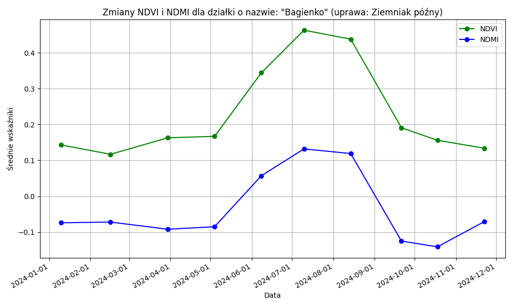
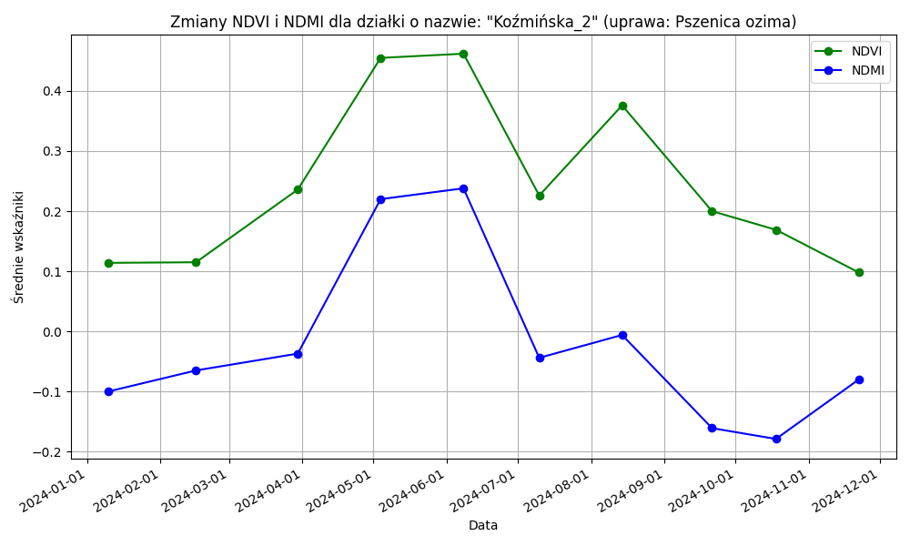
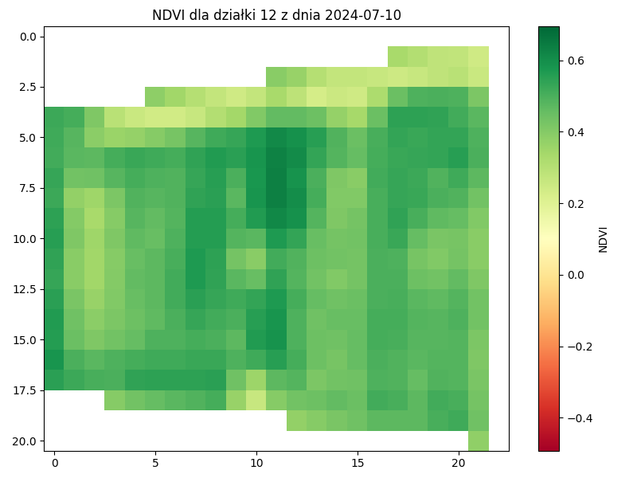

# Sentinel-2 Crop Monitoring with PostgreSQL and PostGIS

A university project by **Jakub Maciejak** combining Python automation, spatial databases and satellite data to monitor agricultural vegetation over time.

The workflow imports field boundaries and Sentinel-2 imagery, calculates NDVI and NDMI inside PostgreSQL/PostGIS, and summarises the results by field and acquisition date. Python scripts query the database to display time series and an NDVI raster.

**Technologies:** Python · PostgreSQL · PostGIS Raster · SQL · GeoPandas · Rasterio · NumPy · Matplotlib

## What the project demonstrates

- Automating a multi-stage raster and vector data-processing workflow.
- Designing tables for imagery, metadata, vegetation indices and field-level results.
- Using SQL joins, coordinate transformations, raster algebra and zonal statistics.
- Tracking processed archives and querying changes over time.
- Separating database credentials from source code in this portfolio edition.

## Workflow

1. Read parcel polygons from a Shapefile and transform them to EPSG:2180.
2. Extract locally downloaded Sentinel-2 ZIP archives and read acquisition dates.
3. Import B04, B08 and B11 rasters using raster2pgsql and psql.
4. Remove tiles outside the parcel extent and merge tiles by band and date.
5. Calculate NDVI = (B08 − B04) / (B08 + B04).
6. Calculate NDMI = (B08 − B11) / (B08 + B11), resampling B08 to the B11 grid.
7. Clip index rasters to parcel boundaries and store mean index values.
8. Query the results to visualise temporal changes and within-field variability.

The report describes Sentinel-2 L2A imagery. This implementation assumes raster coordinates in **EPSG:32634**. Assigning an SRID during import does not reproject a raster.

## Example results

These are historical figures extracted from the author's June 2025 academic report, using observations from 2024. They have not been regenerated from the packaged code. Original chart labels remain in Polish.

### Potato field: seasonal development



The example shows increasing vegetation activity towards early July followed by a decline. NDMI follows a broadly similar seasonal pattern. These indices describe spectral changes; they do not independently establish crop health or yield.

### Winter wheat: seasonal changes



The report interprets the summer decrease as potentially associated with harvest. This is an interpretation of a sparse time series, rather than a verified detection of an agricultural operation.

### Within-field NDVI variability



The raster example shows spatial differences within a field on one acquisition date. Interpretation is limited by pixel resolution, image quality and the number of observations.

## Repository contents

| Path | Purpose |
| --- | --- |
| `src/skrypt_bazy_main.py` | Main import and NDVI/NDMI processing workflow |
| `src/skrypt_bazy.py` | Earlier NDVI-only implementation, retained for reference |
| `src/skrypt_bazy_wykresy.py` | Field-level NDVI/NDMI time-series chart |
| `src/skrypt_bazy_wizualizacja.py` | NDVI raster visualisation for one field/date |
| `src/config.py` | Shared configuration and import guard |
| `sql/enable_extensions.sql` | PostGIS extension setup |
| `assets/` | Selected historical results from the report |
| `docs/implementation-notes.md` | Changes, limitations and validation scope |
| `.env.example` | Configuration template without a real password |

Polish filenames, database columns and code comments are retained from the academic implementation.

## Local setup

Use a **dedicated, disposable project database**. Import recreates `dzialki`, removes temporary raster records and clears `work/extracted/`. Do not use a shared or production database.

### 1. Prerequisites

- Python with the packages listed in `requirements.txt`.
- PostgreSQL with PostGIS and PostGIS Raster installed.
- `psql` and `raster2pgsql` available on PATH, with support for the source raster format.
- A graphical environment for interactive Matplotlib windows.
- A database role with permissions for the project tables. Extension installation may require an administrator.

Python dependencies are an inferred, unpinned list, not a tested environment lockfile.

```bash
python -m venv .venv
# Activate .venv using the command appropriate for your operating system.
python -m pip install -r requirements.txt
```

Create a project database and enable the extensions using `sql/enable_extensions.sql` in that database.

### 2. Configure locally

Copy `.env.example` to `.env` and fill in your own credentials. The scripts load `.env` automatically; existing environment variables take precedence.

Never commit `.env`. Keep `ALLOW_TABLE_REBUILD=false` until you have checked the database target and accepted the table-rebuild behaviour.

### 3. Provide inputs

Place a complete parcel Shapefile under `data/parcels/` (including sidecar files), and trusted Sentinel-2 archives under `data/sentinel/`. Alternatively, change the corresponding paths in `.env`.

Expected parcel attributes: `id`, `Nazwa`, `Pow`, `Uprawa`, `Nr_dzialek`, `Naz_obreb`, `Nr_obreb`. The import expects polygon geometries and a defined source CRS.

Input imagery, parcel data and database dumps are not distributed. The extraction folder is disposable and must not contain personal files.

### 4. Run the main workflow

After checking the target, set `ALLOW_TABLE_REBUILD=true` locally, then:

```bash
python src/skrypt_bazy_main.py
```

Use the main script for NDVI **and** NDMI. Do not run the earlier NDVI-only script against the same database: its result-table schema is different.

### 5. Explore the results

Adjust `DZIALKA_ID` and the date filter in the chart script, or `DZIALKA_ID` and `DATA_POZYSKANIA` in the raster script.

```bash
python src/skrypt_bazy_wykresy.py
python src/skrypt_bazy_wizualizacja.py
```

Raster export with `ST_AsGDALRaster` also requires an available and enabled GeoTIFF GDAL driver in the database installation.

## Scope and limitations

This is an academic prototype, not a production-ready monitoring service.

- Full execution requires the original-format inputs and a suitable PostGIS installation; these were not available during packaging.
- The file finder chooses the first matching band. Explicit resolution/tile selection should be added before processing varied products.
- No cloud/shadow mask or complete radiometric scaling/offset handling is implemented.
- The index expressions retain the original calculation and do not explicitly guard a zero denominator.
- The workflow is designed for sequential use. It is not transactionally safe across the entire import and does not support concurrent runs.
- Archive tracking skips completed ZIPs; changes to parcels or additional bands require a considered rebuild/reprocessing strategy.
- Database routines retain academic assumptions about schemas, raster alignment and metadata. Validate against the installed PostGIS version before relying on numerical results.

## Authorship and source material

**Jakub Maciejak**, Wrocław University of Science and Technology. Academic report: *Zautomatyzowany monitoring stanu roślinności działek rolnych z wykorzystaniem danych Sentinel-2 przy użyciu PostgreSQL i języka programowania Python*, 10 June 2025.

This portfolio edition externalises credentials and local paths and adds documentation and basic execution safeguards. The original PDF is intentionally not bundled because a screenshot exposes database credentials. Selected result figures are included instead.

The separately supplied `histogramy.py` analyses displacement/GACOS NetCDF files and is unrelated to this crop-monitoring workflow, so it is not included.

[LinkedIn](https://www.linkedin.com/in/jakub-maciejak-3aa280277/) · [GitHub](https://github.com/Maciejuu)
